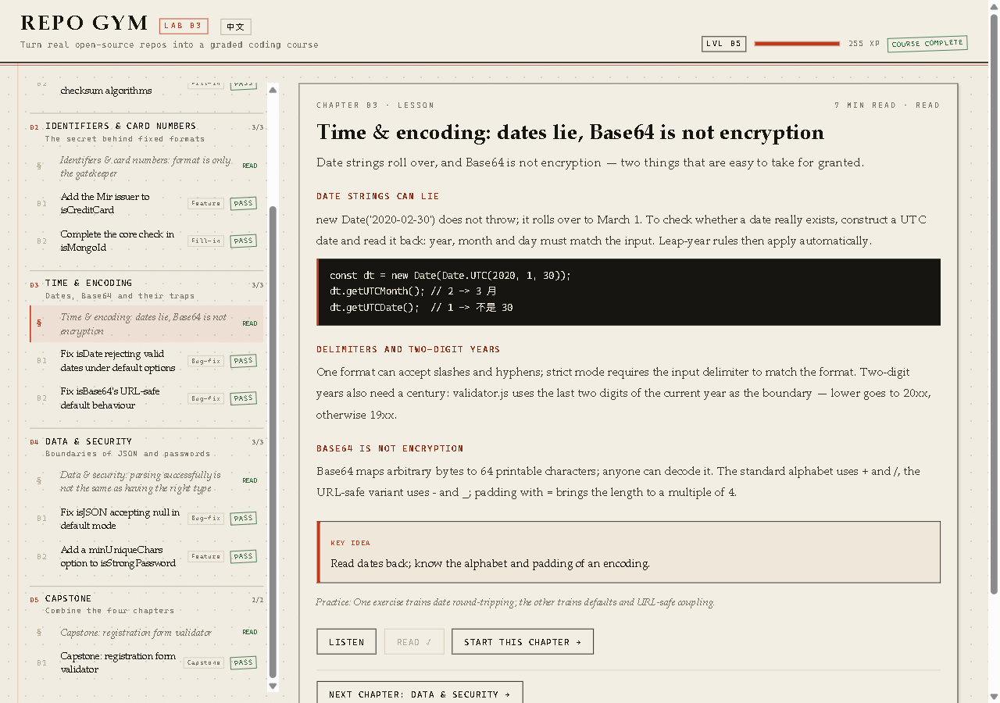

# Repo Gym

**Turn a real open-source repository into a short, auto-graded JavaScript course.**

Live demo: https://max-code7997.github.io/repo-gym/



## The course

A five-chapter mini-course built around real code from [validator.js](https://github.com/validatorjs/validator.js):

1. **Checksums** — Luhn, ISBN-10/13. Lesson + 2 exercises.
2. **Identifiers & card numbers** — BIN ranges, ObjectId. Lesson + 2 exercises.
3. **Time & encoding** — date round-trips, Base64. Lesson + 2 exercises.
4. **Data & security** — JSON type boundaries, password rules. Lesson + 2 exercises.
5. **Capstone** — build `validateSignup`, a registration-form validator. 12 tests.

9 exercises in total: 3 fill-in, 3 bug-fix, 2 feature, 1 project. Each exercise ships with hidden test expressions, hints, a reference solution and an explanation.

## How it works

- The site is a static page (`index.html` + `data.js`), no backend, no CDN, no external fonts.
- Your code and the tests run inside a `sandbox="allow-scripts"` iframe.
- Progress, best completion state, XP, lesson reads and editor code are stored in `localStorage`.
- XP: lesson 15, easy 10, medium 20, hard 30, capstone 50. Five levels, Newcomer → Maintainer.
- Every lesson and exercise prompt is available in 中文 and English (top-bar toggle). Lessons and prompts can be read aloud with the browser's built-in speech synthesis.
- An offline course tutor answers questions about concepts, the current exercise, failing tests and the next item. It uses only the bundled course content — no network, no API key. Read-aloud uses system voices; voice input depends on the browser.

### Offline tutor

Click **ASK** in the bottom-right corner. It answers from the lessons, exercises, hints and your last test run; it never calls an API. Use **Listen** on an answer to read it aloud. The **MIC** button uses the browser's speech recognition where available (this may use the browser's online service; the rest of the tutor is offline).

## How it was built

Built with **AutoClaw** (GLM-5.3) in four passes:

1. **Repo analyst** — inventory, pick pure functions with at most three internal dependencies, check the licence.
2. **Exercise designer** — one task per function with starter code, reference solution, tests, hints and explanation.
3. **Independent auditor** — reference must pass every test; starter must fail at least one; each solution gets three semantic mutations that the tests must catch.
4. **Site builder** — the static app with an in-browser test runner.

AutoClaw generated the exercise packs and the site. The course structure, lesson notes, capstone brief and the final test fixes were written and verified by the author. The English edition is a human translation of the Chinese content.

The audit is in [audit.md](audit.md): **26/27 mutants killed; 1 mutant proven equivalent.** The equivalent mutant is documented in the matrix: in 2026, the two branches it changes map to 1926 and 2026, both non-leap years, so `isDate` cannot distinguish them.

## Reuse the method

[pipeline.md](pipeline.md) contains the four prompts and the acceptance matrix. Point it at another repository to generate a new pack.

## Run locally

```bash
python -m http.server 8000
```

Open <http://localhost:8000>.

## Files

| Path | Purpose |
|---|---|
| `index.html` | The app: inline CSS/JS, no external resources |
| `data.js` | `window.EXERCISES` + `window.CURRICULUM` |
| `exercises/` | Source JSON for every exercise |
| `curriculum.json` | Chapters, lessons and exercise mapping |
| `audit.md` | Mutation-testing matrix |
| `pipeline.md` | Reusable generation and verification prompts |
| `docs/` | Screenshots |

## Attribution

Exercise content is derived from validator.js (MIT, commit `9ff3424`) and used for teaching only. Visual effects are adapted from ReactBits' SpotlightCard and DecryptedText and reimplemented in vanilla CSS/JS.

## Licence

MIT — see [LICENSE](LICENSE).
